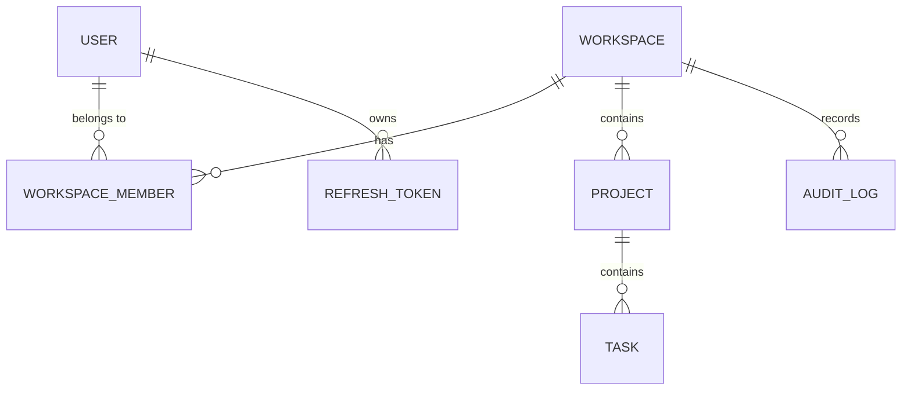

# Multi-Tenant Task & Project Management Portal

A SaaS-style task management backend (think a small Trello/Jira) where **many organizations share one app and one database, but can never see each other's data**.

> **Status: in progress.** The REST API is complete and tested. A React + Tailwind Kanban frontend and cloud deployment are next.

## Highlights

- **Multi-tenancy with strict data isolation**: every request is checked against workspace membership, and every query is scoped to the workspace. Cross-tenant access attempts return `404`.
- **Authentication**: JWT access tokens (15 min) and refresh tokens (7 days) with **rotation** (a refresh token can only be used once) and logout. Passwords are hashed with bcrypt.
- **Role-based access control**: `ADMIN`, `MEMBER` and `VIEWER` roles are assigned per workspace, so one user can be an admin in one organization and a viewer in another.
- **Audit log**: task status changes are recorded (who, what, when, old and new value) inside the same database transaction as the change.
- **Automated integration tests** (Vitest + Supertest) for authentication, refresh tokens, RBAC, tenant isolation and the audit log. They run against a separate test database and refuse to run against any other one.
- **Validated configuration**: the server checks required environment variables at startup and exits with a clear message if something is missing.

## Tech stack

| Area | Technology |
|---|---|
| Runtime / language | Node.js, TypeScript |
| Web framework | Express |
| Database | PostgreSQL (Docker for local development) |
| ORM / migrations | Prisma |
| Auth | JWT (`jsonwebtoken`), bcrypt (`bcryptjs`) |
| Validation | Zod |
| Testing | Vitest, Supertest |
| Planned | React, Vite, Tailwind CSS, drag-and-drop Kanban board |

## Architecture

```
Client ──HTTP──▶ Express ──▶ middleware ──▶ route ──▶ service ──▶ Prisma ──▶ PostgreSQL
                              │
                              ├─ requireAuth            verify JWT, identify the user
                              └─ requireWorkspaceRole   membership + role check (404 / 403)
```

```
backend/
├── prisma/            schema.prisma and migrations
├── src/
│   ├── config.ts      validated environment variables
│   ├── app.ts         routes, CORS, JSON parsing
│   ├── server.ts      entry point
│   ├── lib/           Prisma client
│   ├── middleware/    auth.ts, workspace.ts
│   ├── utils/         hash.ts, jwt.ts
│   └── modules/       auth, workspaces, projects, tasks, audit
│                      (each: *.routes.ts for HTTP, *.service.ts for logic and queries)
└── tests/             integration tests
```

## Data model



The role lives on `WorkspaceMember` (not on `User`), which is what lets one person hold different roles in different workspaces. A task has no `workspaceId` of its own: it belongs to a project, which belongs to a workspace, so access checks always follow that chain.

## Roles and permissions

| Action | ADMIN | MEMBER | VIEWER |
|---|:-:|:-:|:-:|
| View members, projects, tasks | ✅ | ✅ | ✅ |
| Create projects and tasks, update tasks | ✅ | ✅ | ❌ |
| Delete projects and tasks | ✅ | ❌ | ❌ |
| Add / remove members | ✅ | ❌ | ❌ |
| Read the audit log | ✅ | ❌ | ❌ |

The last admin of a workspace cannot be removed.

## How tenant isolation works

1. **Membership check**: every workspace route verifies that the caller is a member. Non-members get `404`, so they cannot even tell whether a workspace exists. A member whose role is too low gets `403`.
2. **Scoped queries**: projects are looked up by `id` **and** `workspaceId`; tasks are looked up through `project: { workspaceId }`. Passing another organization's IDs through your own workspace URL finds nothing.
3. **Assignee check**: a task can only be assigned to a member of the same workspace.

The integration tests attempt these cross-tenant reads, updates and deletes and assert that they fail.

## API overview

All routes except `register`, `login`, `refresh`, `logout` and `/health` require `Authorization: Bearer <access token>`.

| Method | Endpoint | Access |
|---|---|---|
| POST | `/api/auth/register` | public |
| POST | `/api/auth/login` | public |
| POST | `/api/auth/refresh` | public (valid refresh token) |
| POST | `/api/auth/logout` | public |
| GET | `/api/auth/me` | authenticated |
| POST, GET | `/api/workspaces` | authenticated |
| GET | `/api/workspaces/:ws/members` | any member |
| POST, DELETE | `/api/workspaces/:ws/members` | ADMIN |
| GET | `/api/workspaces/:ws/projects` | any member |
| POST | `/api/workspaces/:ws/projects` | ADMIN, MEMBER |
| DELETE | `/api/workspaces/:ws/projects/:id` | ADMIN |
| GET | `/api/workspaces/:ws/projects/:p/tasks` | any member |
| POST, PATCH | `/api/workspaces/:ws/projects/:p/tasks` | ADMIN, MEMBER |
| DELETE | `/api/workspaces/:ws/projects/:p/tasks/:id` | ADMIN |
| GET | `/api/workspaces/:ws/audit-logs` | ADMIN |

Example:

```bash
# register and log in
curl -X POST http://localhost:4000/api/auth/register \
  -H "Content-Type: application/json" \
  -d '{"email":"me@example.com","name":"Me","password":"password123"}'

curl -X POST http://localhost:4000/api/auth/login \
  -H "Content-Type: application/json" \
  -d '{"email":"me@example.com","password":"password123"}'

# create a workspace with the returned access token
curl -X POST http://localhost:4000/api/workspaces \
  -H "Authorization: Bearer <accessToken>" \
  -H "Content-Type: application/json" \
  -d '{"name":"ABC Company"}'
```

## Getting started

**Prerequisites:** Node.js 22 or newer (developed on Node 24), Docker Desktop, Git.

```bash
git clone https://github.com/Kaveesha358/multi-tenant-task-portal.git
cd multi-tenant-task-portal

# 1. start PostgreSQL
docker compose up -d

# 2. install and configure the backend
cd backend
npm install
cp .env.example .env        # on Windows PowerShell: Copy-Item .env.example .env
```

Edit `backend/.env` and replace the two JWT placeholders with long random strings (at least 16 characters; the server refuses to start otherwise). You can generate them with:

```bash
node -e "console.log(require('crypto').randomBytes(32).toString('hex'))"
```

Then create the tables and start the server:

```bash
npx prisma migrate deploy
npx prisma generate
npm run dev                 # http://localhost:4000, health check at /health
```

### Environment variables

| Variable | Purpose | Default |
|---|---|---|
| `PORT` | HTTP port | `4000` |
| `DATABASE_URL` | PostgreSQL connection string | none |
| `JWT_ACCESS_SECRET` | signs access tokens | none (min 16 chars) |
| `JWT_REFRESH_SECRET` | signs refresh tokens | none (min 16 chars) |
| `CORS_ORIGIN` | allowed frontend origin(s), comma-separated | `http://localhost:5173` |

## Running the tests

Tests use a separate database so your development data is never touched.

```bash
# one-time: create the test database
docker exec task-portal-db psql -U postgres -c "CREATE DATABASE taskportal_test;"

# then, from backend/
npm test
```

The test setup applies the migrations to `taskportal_test` automatically, and aborts if `DATABASE_URL` does not point to a database whose name contains `_test`.

## Design decisions

- **404 vs 403**: non-members get `404` rather than `403` so workspace existence is not leaked to outsiders.
- **One error for failed logins**: wrong email and wrong password return the same `401`, so the API cannot be used to discover which emails are registered.
- **Refresh token rotation**: each refresh token is deleted when used and replaced with a new one, so a stolen, already-used token is useless. Logout deletes the token.
- **Transactions**: a task update and its audit log entry are written together; either both are saved or neither is.
- **Validation at the edge**: request bodies are validated with Zod before any logic runs, and the environment is validated at startup.

## Roadmap

- [x] Authentication with refresh-token rotation and logout
- [x] Workspaces, members and role-based access control
- [x] Projects and tasks with tenant isolation
- [x] Audit log for task status changes
- [x] Automated integration tests
- [ ] React + TypeScript + Tailwind frontend with a drag-and-drop Kanban board
- [ ] Deployment (frontend on Vercel, backend on Render, PostgreSQL on Neon)
- [ ] CI with GitHub Actions (run tests on every push)
- [ ] Rate limiting and security headers

## Author

**Kaveesha De Silva**, IT undergraduate (BSc Hons in IT, Horizon Campus)
[GitHub](https://github.com/Kaveesha358) · [LinkedIn](https://linkedin.com/in/kaveesha-de-silva-dev)
